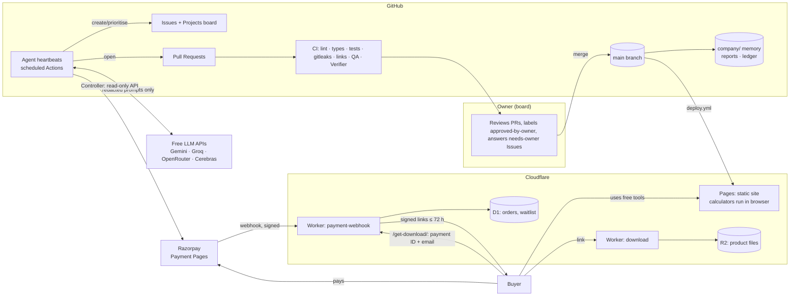
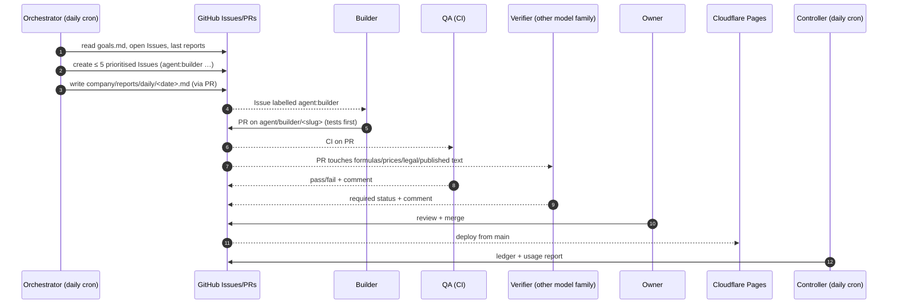
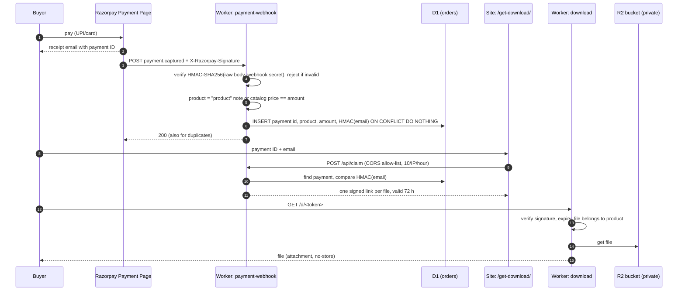

# Architecture

"The company is the repo." GitHub holds the work, the memory and the approvals; Cloudflare
serves the storefront and handles payments/delivery; free LLM APIs power the agents.

## 1. System overview

## 2. Work loop (one agent cycle)

## 3. Purchase and delivery (Phase 3, ADR-023)

## 4. Data flows and trust boundaries

| Data                         | Lives in                              | May go to an LLM?           |
| ---------------------------- | ------------------------------------- | --------------------------- |
| Calculator inputs            | Buyer's browser only                  | Never (never leaves device) |
| Waitlist emails              | Cloudflare D1                         | Never                       |
| Buyer email, name, phone     | Razorpay only; D1 keeps an email HMAC | Never                       |
| Payment/order IDs, amounts   | Razorpay; D1; `company/ledger/*.csv`  | Never                       |
| Support message text         | Support inbox → agent run memory      | Only after redaction        |
| Goals, policies, KB, reports | `company/` in git                     | Yes (no PII by rule)        |
| Secrets                      | GitHub Secrets / Cloudflare env       | Never                       |

## 5. Agent runtime

- Each agent is `agents/<name>/run.ts`, invoked by a workflow in `.github/workflows/`
  (cron + `workflow_dispatch`), running with `tsx` on Node 22.
- Shared code in `agents/lib/`: OpenAI-compatible LLM client with provider fallback
  (`providers.json`), 429 backoff, per-agent daily token budget (hard stop), redaction,
  zod schema validation (invalid → retry once → escalate), structured logs to
  `company/reports/agent-logs/`, `DRY_RUN=true` mode.
- Agents write to the repo **only through PRs**; workflows get least-privilege `permissions:`.
- Verifier always uses a different model family from the producer of the output it checks.

## 6. Why static-first

All calculators are pure functions in `tools-core`, bundled into static pages. No server
means no hosting cost, no user data risk and near-perfect Lighthouse scores. The only server
code is two small Workers for payments and delivery.
